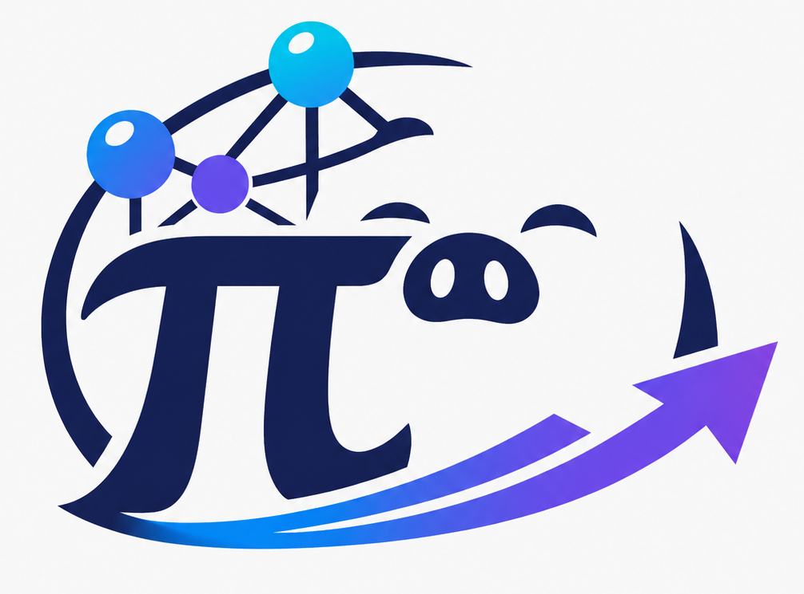

<p align="center">
  
</p>

# pi-graph

[中文](README.md) | **English**

Durable, auditable multi-agent state-graph orchestration for the [Pi agent harness](https://github.com/earendil-works/pi).

`pi-graph` organizes parallel research, specialized roles, independent review, human approval, and failure recovery with explicit state, nodes, edges, and reducers. Every agent node still runs in process through the Pi SDK.

> Prefer one Pi agent loop for simple work. Use a graph only when the task genuinely needs parallelism, an independent reviewer, persistent role memory, or a human gate.

## Install

Requires Node.js `>= 22.19.0` and an installed copy of Pi.

Install from npm:

```bash
pi install npm:@shying/pi-graph
```

## Quick start

Graphs are discovered from:

| Scope | Path |
|---|---|
| User | `~/.pi/agent/graphs/*.json` |
| Current project | `<project>/.pi/graphs/*.json` |

Project graphs load only after Pi trusts the current project. Install an example to get started:

```bash
mkdir -p ~/.pi/agent/graphs
curl -fsSL https://raw.githubusercontent.com/huang-sh/pi-graph/main/examples/research-review.json \
  -o ~/.pi/agent/graphs/research-review.json
```

Start Pi, then run:

```text
/pig list
/pig validate research-review
/pig visualize research-review
/pig run research-review Design a safe cache invalidation strategy for this repository
```

If the graph pauses at a `human` node:

```text
/pig resume <runId> true
```

## Core model

```text
input → entry → fan-out → barrier → reviewer → loop / end
```

Within each superstep, nodes read the same immutable state. Successful writes are committed together at the end of the step. Parallel nodes writing the same path must declare a reducer.

### Nodes

| Type | Purpose |
|---|---|
| `agent` | Agent work such as research, implementation, and review |
| `set` | Deterministic state transformations |
| `human` | Pause for approval, a choice, or input |

### Agent context

| Mode | Best suited for |
|---|---|
| `isolated` | Independent reviewers, parallel branches, one-shot experts |
| `thread` | One role retaining private Pi session history across a loop |
| `shared` | Several nodes using an auditable graph-state message channel |

The default is `thread` (since 0.1.0; previously `isolated`), so undeclared agent nodes keep private session history across loops. The same `threadKey` cannot run concurrently or span different `cwd` values.

When authoring a graph:

- use `edges` for static links, fan-out, barriers, and conditional loops;
- use `response.schema` to validate critical agent handoffs;
- use `collect` for current-round parallel results instead of unbounded loop accumulation;
- store large reports as artifacts and keep only summaries and references in state;
- use graph limits to bound the whole run and node limits to bound one agent invocation.

See the [graph schema](docs/SCHEMA.md) for every field, or copy an existing graph from [examples](examples/).

## Commands

```text
/pig list
/pig validate [graph]
/pig run <graph> [task or JSON]
/pig resume <runId> [value or JSON]
/pig inspect [runId] [--full|--inventory|state.path]
/pig delete <runId>
/pig visualize <graph>
```

Models can also call `pi_graph_run`, `pi_graph_resume`, and `pi_graph_inspect`. Active runs show a compact node-status and token board.

`/pig inspect` is summary-first. `/pig delete` confirms before removing checkpoints, private thread history, and artifacts.

## Examples

| Example | Demonstrates |
|---|---|
| [research-review](examples/research-review.json) | Parallel research, barrier join, thread writer, independent reviewer |
| [coding-review](examples/coding-review.json) | Persistent coder, review, human approval, revision loop |
| [shared-handoff](examples/shared-handoff.json) | Shared message channel |
| [idea-tournament](examples/idea-tournament.json) | Multi-way fan-out and barrier judge |
| [open-ended-debate](examples/open-ended-debate.json) | Neutral topic allocation, two persistent debaters, concession routing |
| [science-research](examples/science-research.json) | Human gate, research loop, artifact report |
| [science-research-auto](examples/science-research-auto.json) | Automated research graph for headless/CI use |



## Persistence and safety

- The extension manages run data under `~/.pi/agent/pi-graph/`; use `/pig inspect`, `/pig resume`, and `/pig delete` to manage it.
- Checkpoints provide at-least-once recovery, not exactly-once external effects; retried mutations still need idempotency.
- `readOnly` is a tool allowlist, not an operating-system sandbox. Run high-risk workflows in a container or OS sandbox.
- Non-interactive runs require `policy.allowNonInteractive`; non-interactive mutations also require `policy.allowNonInteractiveMutations`.
- Graph and node timeouts cancel cooperatively through an abort signal, so providers and tools must honor cancellation promptly.

See [Architecture](docs/ARCHITECTURE.md) for implementation and failure semantics.

## Development

```bash
npm run check
npm test
npm run validate:examples
```

- [Schema reference](docs/SCHEMA.md)
- [Architecture](docs/ARCHITECTURE.md)
- [Changelog](CHANGELOG.md)

## License

[MIT](LICENSE)
