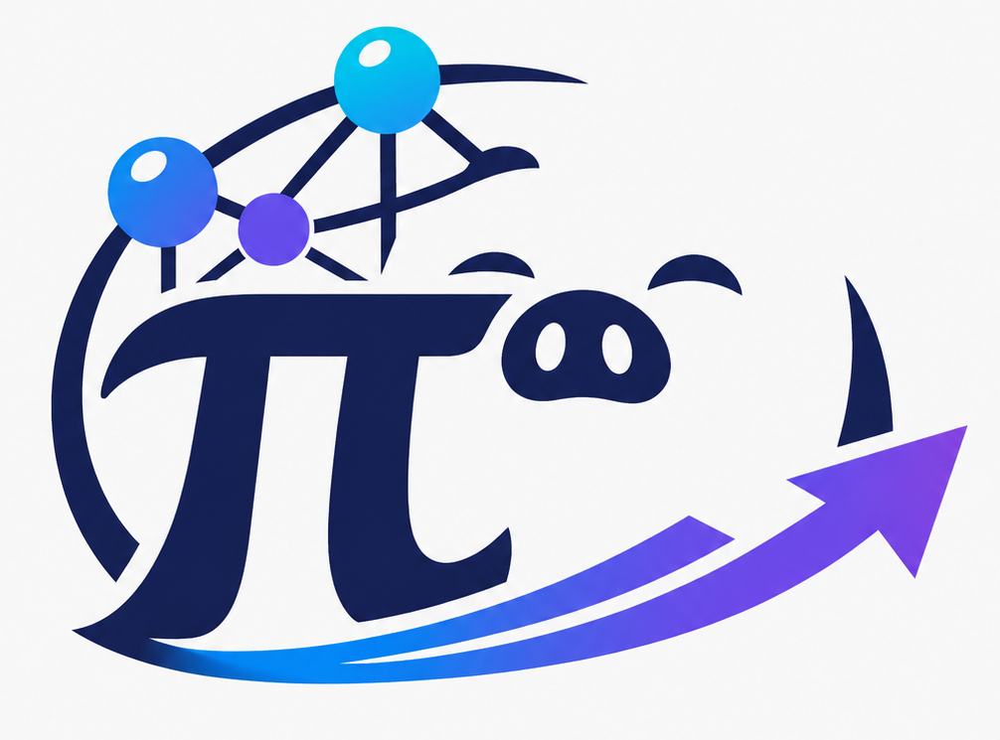

<p align="center">
  
</p>

# pi-graph

**中文** | [English](README.en.md)

为 [Pi agent harness](https://github.com/earendil-works/pi) 提供可恢复、可审计的多 Agent 状态图编排。

`pi-graph` 用显式 state、nodes、edges 和 reducers 组织并行研究、专业分工、独立审查、人工审批与失败恢复。所有 Agent 节点仍通过 Pi SDK 在进程内运行。

> 简单任务优先使用一个 Pi agent loop。只有确实需要并行、独立 reviewer、持久角色记忆或人工门控时才使用图。

## 安装

要求 Node.js `>= 22.19.0`，并已安装 Pi。

从 npm 安装：

```bash
pi install npm:@shying/pi-graph
```

## 快速开始

图从以下位置发现：

| 范围 | 路径 |
|---|---|
| 用户 | `~/.pi/agent/graphs/*.json` |
| 当前项目 | `<project>/.pi/graphs/*.json` |

项目图只在 Pi 信任当前项目后加载。可以先安装一个示例：

```bash
mkdir -p ~/.pi/agent/graphs
curl -fsSL https://raw.githubusercontent.com/huang-sh/pi-graph/main/examples/research-review.json \
  -o ~/.pi/agent/graphs/research-review.json
```

启动 Pi 后：

```text
/pig list
/pig validate research-review
/pig visualize research-review
/pig run research-review 为这个仓库设计一个安全的缓存失效方案
```

如果图在 `human` 节点暂停：

```text
/pig resume <runId> true
```

## 核心模型

```text
input → entry → fan-out → barrier → reviewer → loop / end
```

每个 superstep 中的节点读取同一份不可变 state；成功写入在 step 结束时统一提交。并行节点写入同一路径时必须配置 reducer。

### 节点

| 类型 | 用途 |
|---|---|
| `agent` | 研究、实现、审查等 Agent 工作 |
| `set` | 确定性状态转换 |
| `human` | 暂停并请求批准、选择或输入 |

### Agent 上下文

| 模式 | 适合场景 |
|---|---|
| `isolated` | 独立 reviewer、并行分支、一次性专家 |
| `thread` | 同一职责跨循环保留私有 Pi session 历史 |
| `shared` | 多个节点共享可审计的 graph-state 消息通道 |

未声明 `context` 时默认使用 `thread`（0.1.0 起，之前为 `isolated`），未声明的 agent 节点在循环中保留私有会话历史。同一 `threadKey` 不能并发运行或跨不同 `cwd`。

编写图时：

- 使用 `edges` 表示静态连接、fan-out、barrier 和条件回环；
- 使用 `response.schema` 校验关键 Agent handoff；
- 使用 `collect` 汇总当前轮并行结果，避免循环中无限累积；
- 大型报告使用 artifact，state 只保留摘要和引用；
- 用 graph limits 约束整个 run，用 node limits 约束单个 Agent 调用。

完整字段见 [Graph Schema](docs/SCHEMA.md)；可直接从 [examples](examples/) 复制现有图。

## 命令

```text
/pig list
/pig validate [graph]
/pig run <graph> [task or JSON]
/pig resume <runId> [value or JSON]
/pig inspect [runId] [--full|--inventory|state.path]
/pig delete <runId>
/pig visualize <graph>
```

模型也可以调用 `pi_graph_run`、`pi_graph_resume` 和 `pi_graph_inspect`。运行时会显示简洁的节点状态与 token 看板。

`/pig inspect` 默认返回摘要；`/pig delete` 会确认后清理 checkpoint、私有 thread 历史和 artifacts。

## 示例

| 示例 | 展示能力 |
|---|---|
| [research-review](examples/research-review.json) | 并行研究、barrier、thread writer、独立 reviewer |
| [coding-review](examples/coding-review.json) | 持久 coder、审查、人工批准、修订循环 |
| [shared-handoff](examples/shared-handoff.json) | shared 消息通道 |
| [idea-tournament](examples/idea-tournament.json) | 多路 fan-out 与 barrier judge |
| [open-ended-debate](examples/open-ended-debate.json) | 中立分题、两个持久辩手、认输条件边 |
| [science-research](examples/science-research.json) | 人工门控、研究循环、artifact 报告 |
| [science-research-auto](examples/science-research-auto.json) | 可用于 headless/CI 的自动研究图 |



## 持久化与安全

- Run 数据由扩展保存在 `~/.pi/agent/pi-graph/`；使用 `/pig inspect`、`/pig resume` 和 `/pig delete` 管理。
- Checkpoint 提供 at-least-once 恢复，不保证外部副作用 exactly-once；可重试写操作仍需幂等。
- `readOnly` 是工具 allowlist，不是操作系统 sandbox；高风险工作流应放入容器或 OS sandbox。
- 非交互运行需要 `policy.allowNonInteractive`；非交互写操作还需要 `policy.allowNonInteractiveMutations`。
- Graph/node timeout 通过 abort signal 协作终止，provider 和 tool 需要及时响应取消。

实现与故障语义见 [Architecture](docs/ARCHITECTURE.md)。

## 开发

```bash
npm run check
npm test
npm run validate:examples
```

- [Schema reference](docs/SCHEMA.md)
- [Architecture](docs/ARCHITECTURE.md)
- [Changelog](CHANGELOG.md)

## License

[MIT](LICENSE)
