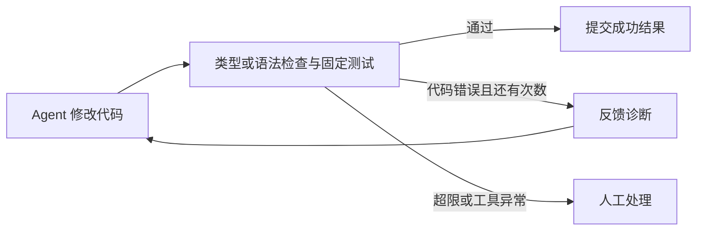

# GateNode

**中文** | [English](README.en.md)

基于 [pi-graph](https://github.com/huang-sh/pi-graph) 的 Agent 代码验收与限次修复扩展。在 Pi 终端中运行编码任务，由确定性检查决定是否接受结果；失败诊断反馈给下一轮 Agent，超限或检查器异常时转入人工处理。



## 功能

- TypeScript：`tsc --noEmit` 与 Node Test Runner。
- Python：语法检查与标准库 `unittest`。
- 结构化错误反馈、独立修复轮次、共享节点预算与取消信号。
- 测试和配置文件变更检测、逐轮 JSON 报告、人工暂停与恢复。

## 环境与安装

- Node.js 22.19 或更高版本。
- Python 3.10 或更高版本，用于 Python 模式和完整测试。
- 在 Pi 中配置可用的模型服务，用于实际 Agent 运行。

在仓库根目录安装依赖：

```sh
npm ci --ignore-scripts
```

Pi 由项目依赖提供，无需全局安装。PowerShell 中可使用 `npm.cmd` 代替 `npm`。

## 在 Pi 中运行 TypeScript 任务

在终端执行：

```sh
npm run demo:prepare
npm start
```

`demo:prepare` 将 `demo/fixture/` 复制到新的工作区，并打印源码路径。`npm start` 打开 Pi 终端聊天界面，加载本项目扩展。

信任当前项目，在 Pi 中使用 `/model` 选择已配置的模型，然后输入：

```text
/pig list
/pig validate coding-gate
/pig run coding-gate 给 listItems 增加分页参数，保持旧调用方式兼容
```

也可以在启动时指定模型：`npm start -- --model provider/model-id`。

## 修改 Python 文件

原代码放在 `python-input/src/`，验收测试放在 `python-input/tests/`：

```text
python-input/
├── src/main.py
└── tests/test_main.py
```

测试使用 `unittest.TestCase`，文件名为 `test_*.py`。示例包含一个待修复的加法函数；可替换源码和测试，也可以使用其他文件名。准备脚本会生成允许修改的源码清单。

```sh
npm run python:prepare
npm start
```

在 Pi 聊天框输入：

```text
/pig validate python-gate
/pig run python-gate 根据 tests 中的验收要求修复 src 下的代码
```

更新输入文件后重新执行准备命令。仅执行 `/pig run` 会继续使用已有工作区。指定虚拟环境解释器及测试约定见 [Python 输入说明](python-input/README.md)。

## 输入与输出

| 模式 | 输入 | 修改后的代码 |
|---|---|---|
| TypeScript | `demo/fixture/src/` 和 `demo/fixture/tests/` | `demo-output/<时间>/workspace/src/` |
| Python | `python-input/src/` 和 `python-input/tests/` | `demo-output/python/<时间>/workspace/src/` |

准备命令复制输入，Agent 修改工作区副本。输出时间目录在准备时创建；重复运行同一图会更新该工作区中的文件。Python 图的结果还会列出 `outputDirectory` 和 `outputFiles`。

Pi 中的验收报告写入 `<Pi agent directory>/gatenode/reports/`，默认对应 `~/.pi/agent/gatenode/reports/`。报告记录每轮检查状态、诊断和修改文件；`/pig inspect <runId>` 查看工作流记录。

检查失败后进入 `manual` 时，输入 `acknowledge` 确认收到失败信息。确认后的业务状态为 `needs_manual_repair`，需修正问题并重新运行，确认动作不会将代码验收为成功。

## 离线演示与验证

```sh
npm run demo
npm run check
npm test
npm run validate:examples
```

离线演示使用脚本 Agent 和真实检查器，不调用模型 API，覆盖首次通过、修复后通过、尝试耗尽、检查器异常四条路径。真实模型的非交互演示可运行 `npm run demo:live -- --model provider/model-id`。

详见 [测试说明](docs/TESTING.md)。

## 运行约束

- Gate 节点使用 `isolated` 上下文和串行图；默认最多 3 次总尝试。
- 只修改 `src/` 下明确列出的现有源码文件，测试和配置保持不变。
- 校验通过表示配置的检查通过；代码检查不是操作系统沙箱，工作区应可信。
- 文件修改不自动回滚；未通过的候选不会提交成功的图状态。
- 修复中途崩溃需要检查报告后新建运行；人工暂停处的恢复复用 pi-graph。

配置、错误类型和执行边界见 [门控机制](docs/GATE.md)。

## 文档

- [门控配置与执行流程](docs/GATE.md)
- [图定义参考](docs/SCHEMA.md)
- [运行时架构](docs/ARCHITECTURE.md)
- [测试与开发](docs/TESTING.md)
- [更新记录](CHANGELOG.md)

## 许可证

[MIT](LICENSE)。项目基于 pi-graph，来源版本及兼容性修改见 [UPSTREAM.md](UPSTREAM.md)。
